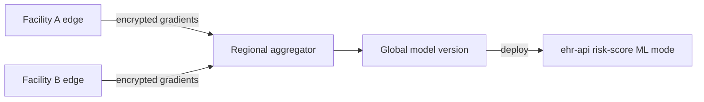

# Federated learning (Blueprint — planned)

## Objective

Train deterioration/readmission models across facilities **without** shipping raw PHI to a central warehouse.

## Target architecture

## Inputs

- Local export per [data-contract.md](../../data-contract.md) (contract v1.0).
- Minimum cohort size and label quality gates per facility.

## Deliverables (future)

- `flwr` client package under `ml/blueprint/federated/client/`
- Aggregator service (out of repo — national control plane)
- Model registry + rollback

## Current repo

Use single-site training: `python3 ml/train/train_deterioration.py` and optional `EHR_AI_RISK_SCORE_MODEL=blend` on gateway.
